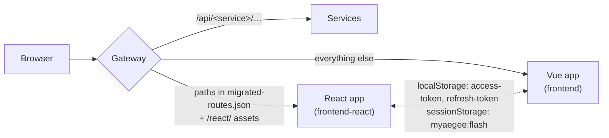

# 03 · Running React next to Vue

The migration moves one route group at a time. During that time both apps are live on the same
origin, and users shouldn't notice which one serves a page, beyond a full page load when they
cross from one to the other. This is how the spike makes that work. All of it runs in the e2e
setups (`E2E_FRONTEND=react` for the real stack, project `react` for the mocked suite).

## Chosen approach: a separate app, routed by path



One list decides which app serves a path:
[`frontend/src/migrated-routes.json`](../../frontend/src/migrated-routes.json).

```json
"patterns": [
  "^/events/?$",
  "^/events/(participating|organizing)/?$",
  "^/events/(?!new/?$|serviceadmin/?$|change_status/?$|boardview/?$)[^/]+/?$",
  "^/events/[^/]+/applications/[^/]+/?$"
],
"assets": "^/react/"
```

It's in the Vue app's source tree because the Vue Docker build only sees `frontend/`, and the
Vue router needs it. Three consumers read it:

| Consumer | What it does with it |
|---|---|
| Gateway (e2e: `e2e/support/frontend-routing.ts`; production: see [below](#production)) | Serves the React build for matching paths and for `/react/*` assets, the Vue build for everything else |
| Vue router (`frontend/src/app.js`), only when built with `VUE_APP_REACT_ROUTES=true` | An in-app navigation to a matching path becomes `window.location.assign()`, so the gateway serves it from React. The first page load isn't affected: if the gateway sent a path to Vue, Vue renders it. That's also the fallback when React isn't deployed. |
| React app (`virtual:vue-app` in `frontend-react/vite.config.ts`) | `AppLink` navigates inside React for matching paths and does a normal link otherwise. A layout guard sends any other path that reaches React (e.g. `/events/new`, which looks like `/events/:id`) back to the server. `src/App.test.tsx` checks that React's routes and the list agree. |

### What the two apps share

| Shared thing | How |
|---|---|
| **Session** | Both read and write `access-token` / `refresh-token` in `localStorage` and renew the same way, so crossing apps never logs anyone out (`ui/events/session.spec.ts`, `coexistence.spec.ts`). Login, signup and password pages stay in Vue until auth moves. React sends visitors to `/login?to=<path>`, and Vue's login returns there. |
| **Page titles, login requirements** | React reads the Vue route table (`routes.js`: `meta.label`, `meta.auth`) at build time |
| **Sidebar menu** | React reads `menu.json` at build time and filters it the same way |
| **Toasts across a page load** | A toast shown just before crossing apps ("Event is deleted.", then going to a page of the other app) would be lost in the page load. Both apps remember the toasts of the last 2 seconds and, when leaving for the other app, write them to `sessionStorage['myaegee:flash']`. The app that loads next shows and clears them (`frontend/src/methods/flash.js`, `frontend-react/src/lib/flash.ts`, tested in `coexistence.spec.ts`). |
| **Static assets** | React's build uses base `/react/` for its own assets and loads shared images (`/images/logo.png`) from the Vue app's paths |
| **Design tokens** | Not yet. `frontend-react/src/styles/tokens.css` could be loaded by the Vue app too, to align colours during the transition (see [roadmap](07-roadmap.md)) |

### What users notice

- **A full page load when crossing apps** (about as long as a first visit, cached after that).
  Inside a migrated group, navigation is client-side. Moving whole route groups at once keeps
  crossings rare: events list → event → application is all React.
- **A different look** between React pages (new tokens, AA contrast) and Vue pages (Bulma).
  Vue could adopt the tokens' colours early to soften this, or accept it as visible progress.
- **The shell is rebuilt in React** (`components/AppShell.tsx`): header, user menu and sidebar.
  It improves on the Vue shell (landmarks, skip link, a keyboard-operable user menu instead of
  a hover dropdown), so it behaves a bit differently, but the menu contents are identical.

## The alternative: React islands inside Vue

Mounting React components inside Vue route components (Vue keeps the shell, router and Vuex):

| | Separate app (chosen) | Islands in Vue |
|---|---|---|
| Unit of migration | route group | component |
| Build | two independent builds (Vite, Vue CLI) | React inside the Vue CLI/webpack 5 build, or a second bundle mounted by hand |
| Runtime | one framework per page | Vue 2 and React on every migrated page (both bundles) |
| Shared state | `localStorage` session + build-time route/menu data | Vuex ↔ React bridge (events or a store adapter); `$root.showError` and `$router` have to be wrapped |
| Shell | rebuilt in React (once) | stays Vue until the very end |
| End state | the React app grows until the Vue app is empty, then the gateway rule is removed | a second migration of the shell, router and bridge at the end |
| Testing | the same black-box specs run against either app | specs have to work across mixed trees; harder to say what "migrated" means |
| Fit for this codebase | good: views are independent and talk to the APIs directly | weak: there are few shared components to swap, and almost everything is page-level |

Islands make sense when an app has many shared leaf components and a heavy shared store. This
app has neither (15 shared components; Vuex holds the session only), so the separate app wins.
One case where an island could still help: a widget the Vue app needs before its page moves
(for example the accessible date picker). That's possible later without changing the approach.

## Production

The spike didn't change production. This is the proposed setup.

**Recommended: one frontend container that serves both builds.** Traefik keeps a single rule for
the frontend, and nginx decides per path. nginx regexes (PCRE) support the lookahead in the
patterns. traefik's (Go) don't, which is another reason to keep this decision in nginx.

```nginx
# Generated from frontend/src/migrated-routes.json at image build time.
location ^~ /react/ {
    alias /usr/app/src/dist-react/;
    expires 1y;            # hashed file names
}
location ~ "^/events/?$|^/events/(participating|organizing)/?$|^/events/(?!new/?$|serviceadmin/?$|change_status/?$|boardview/?$)[^/]+/?$|^/events/[^/]+/applications/[^/]+/?$" {
    root /usr/app/src/dist-react;
    try_files /index.html =404;
    add_header Cache-Control "no-cache";
}
location / {
    try_files $uri $uri/ /index.html;   # the Vue app, as today
}
```

Changes this needs:

1. **Docker build context**: the image needs `frontend/` and `frontend-react/`, so either build
   from the repository root with a Dockerfile that has stages for both apps, or build a separate
   `frontend-react` image and copy its `dist/` in. The React build also reads
   `frontend/src/routes.js`, `menu.json` and `migrated-routes.json`.
2. **Build the Vue app with `VUE_APP_REACT_ROUTES=true`** once React is deployed.
3. **Generate the nginx `location` from the JSON**, so the list can't drift (a 20-line script in
   the image build, like `e2e/support/frontend-routing.ts` does for the e2e gateway).
4. **CircleCI**: build and publish the combined image in `frontend-docker-build-and-push`
   (semantic-release per module stays as it is).

**Rollback** for a route group: remove its patterns from `migrated-routes.json` and redeploy the
frontend. Vue still has the views until the group is deleted from Vue, which should only happen
after a release cycle without rollback.

**The dev setup** (`./start.sh`, the Vue dev server behind traefik) can serve the React dev
server the same way: `npm run dev` in `frontend-react/` proxies `/api` to the gateway, and traefik
or the Vue dev server proxy can forward the migrated paths to it. This wasn't done in the spike.

## Rules for migrating a route group

1. Port the views to `frontend-react/src/pages/` and add their routes in `src/App.tsx`.
2. Add the paths to `frontend/src/migrated-routes.json` (`src/App.test.tsx` checks the two agree,
   and that nearby Vue paths such as `/events/new` aren't captured).
3. Tag the group's mocked-API specs `@migrated`, so they run against both apps. They must pass
   on React before the group switches.
4. Run the real-stack e2e suite with `E2E_FRONTEND=react` (CI does this).
5. Leave the Vue views in place until the switch has been in production for a release, then
   delete them.
