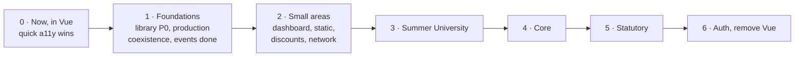

# 07 · Roadmap, sizes and risks

The proposed order of work after the spike, with a size for each area and the things that could
go wrong. Sizes are relative (S/M/L/XL), not dates: team capacity is unknown and volunteer
time varies a lot.

## Phases

| Phase | Contents | Size | Why at this point |
|---|---|:-:|---|
| **0 · Now, in Vue** | Shell a11y fixes (`lang`, logo alt/name, sidebar contrast: at least 340 of the 1,713 flagged elements, [06](06-a11y-baseline.md)); the `main.scss` contrast overrides ([05](05-design-system-inventory.md)); the `Apply.vue` redirect bug. Merge the test harness from this spike. | S | Independent of the migration; improves what users get today and lowers the baseline |
| **1 · Foundations** | Component library P0 set (27 components, [05](05-design-system-inventory.md#proposed-component-list)) with docs and keyboard tests; replace the PoC's ad-hoc markup with it. Production coexistence (Docker/nginx, [03](03-coexistence.md#production)). Code splitting. Finish **events**: picture upload, map (MapLibre + location list), the editor (`Edit.vue`, 1,031 lines), participants, board view, service admin, status pages. Switch `/events/**` in production. | L | Proves the whole path to production on the area the PoC started; the editor brings the form library decision |
| **2 · Small areas** | dashboard + calendar (S: FullCalendar React adapter + agenda list), static pages (S), discounts (M), network (M) | M | Quick wins that grow the library (tables, tabs, file upload) and the team's practice |
| **3 · Summer University** | 11 routes, 4,780 lines; the editor and Single page are like the events ones | L | Reuses events patterns, so it's cheaper after phase 1 |
| **4 · Core** | members, bodies, circles, campaigns, permissions, join requests: 35 routes, 7,181 lines, 80 API calls, 89 tables | XL | Most-used admin area; needs the DataTable (sorting, paging, filters) and member search combobox |
| **5 · Statutory** | Agora/EPM: 31 routes, 8,535 lines, 71 API calls, charts, candidates, question lines, memberslists | XL | Largest and most specialised; chart a11y (data tables); time-critical around statutory events, so schedule it away from Agora preparation periods |
| **6 · Auth, remove Vue** | login, signup, confirmation, password reset, mail change (real-stack tests for the mails); then remove `frontend/`, the hand-off flag and the gateway split | S + clean-up | Vue keeps the login until the end; once nothing is left, the coexistence code goes |

### Sizes per area

| Area | Size | What drives it |
|---|:-:|---|
| statutory | **XL** | 8.5k lines, 71 API calls, 132 form fields, 161 tables, Chart.js + Mapbox + flatpickr + multiselect + input-tag, 27 `v-html` |
| core | **XL** | 7.2k lines, 80 API calls, 109 form fields, 89 tables, 34 programmatic Buefy dialogs/modals, 269 permission checks |
| summeruniversity | **L** | 4.8k lines, 105 form fields, a two-step editor, Mapbox |
| events (rest after the PoC) | **L** | the 1,031-line editor (dynamic question builder, organisers, locations, dates), participants and board view |
| network | **M** | antenna criteria check (1,228 lines, many services) |
| discounts | **M** | small, but its own service and admin tables |
| dashboard | **S** | FullCalendar + ical |
| auth | **S–M** | few pages (the score is on the S/M boundary); risk is in the flows (mails), not the UI |
| static | **S** | about, status, bug report, Confluence pages |

### How the sizes were made

`tools/inventory.mjs` scores each area as `lines/150 + apiCalls·0.5 + formFields/6 + tables/2 +
thirdPartyLibraries·2 + programmaticDialogs/2`, and maps <15 to S, <50 to M, <120 to L and the
rest to XL. The weights are a judgement call. The scores rank areas consistently with reading
the code; they aren't a promise of effort. For calibration: the events PoC replaces 1,270
lines of Vue (list, page and form, 10 API calls) with 710 lines of React pages, plus about 1,100
lines of shell, session, API client, toasts, dialog and styles, which the next areas reuse.

## Risks

| Risk | Likelihood | Impact | Mitigation |
|---|---|---|---|
| The migration stalls halfway (volunteer capacity), leaving two apps for years | medium | high | Route groups are small and self-contained; each switch is useful on its own; Vue keeps working; the phase 0 fixes help both apps |
| The shared JSON / route table drift between the apps | low | medium | One file read by all three consumers; `src/App.test.tsx` checks agreement; the coexistence specs run in CI |
| Mocks drift from the APIs and specs pass against fiction | medium | high | `tests/fixture-contract.spec.ts` in CI; real-stack tests per area; add a contract check with every new factory |
| Visual inconsistency between React (tokens) and Vue (Bulma) pages bothers users | medium | low | Phase 0 contrast fixes bring Vue closer; move whole areas at once |
| Big editors (events, SU, statutory) are harder than the PoC suggests | high | medium | Port events' editor first (phase 1), decide the form library there, reuse it for SU and statutory |
| Map tiles / Mapbox token: mapbox-gl 0.53 is very old and the token setup is unclear | medium | low | MapLibre with an open tile source, plus the text list of locations (already in the PoC) |
| Bundle grows as widgets arrive | medium | medium | Route-level code splitting before phase 2; a CI size budget |
| Keyboard and screen reader quality regresses unnoticed (axe catches about a third) | medium | high | Per-component keyboard tests in Playwright; manual NVDA/VoiceOver passes per library release |
| Auth flow differences between apps (renewal, redirects) | low | high | Same storage keys and renewal protocol; the session specs run on both apps; auth moves last |

## Open questions

The decisions the team needs to make. The ones marked ★ block phase 1.

1. ★ **Confirm the stack** in [02](02-target-stack.md), in particular React Router vs TanStack
   Router (typed search params), and the form library (React Hook Form + Zod is the proposal;
   decide on the events editor).
2. ★ **Production layout for coexistence**: one frontend image serving both builds from nginx
   (proposed), or a separate `frontend-react` image with a traefik rule. Who owns the Docker and
   CircleCI changes?
3. ★ **Brand palette** source of truth, and approval of the AA-adjusted shades and event-type
   colours ([05 open questions 1–2](05-design-system-inventory.md#open-questions-and-decisions-for-the-team)).
4. **Phase 0 in Vue**: do the shell a11y fixes and the `main.scss` contrast overrides now, as
   separate PRs? (Recommended.)
5. **The `Apply.vue` redirect bug**: fix it in Vue now (one line), or leave it to the React port?
6. **Component workbench and visual regression**: Storybook vs Ladle; Playwright screenshots vs
   a hosted service ([05](05-design-system-inventory.md#open-questions-and-decisions-for-the-team), 6–7).
7. **a11y gate**: when to turn the report into a check. The proposal is 0 violations for
   `@migrated` pages and for component stories from phase 1, with Vue staying report-only.
8. **API types**: keep hand-written types per area, or invest in OpenAPI specs for the services
   (also useful for their own tests and for the contract checks)?
9. **Dark mode, icons, fonts, mobile tables** ([05](05-design-system-inventory.md#open-questions-and-decisions-for-the-team), 4, 8–10).
10. **Keep the mocked-API suite in `e2e/`** (as now, with its own config) or move it to
    `frontend-react/` once Vue is gone? It's in `e2e/` because it shares the support code and
    tests both apps.
